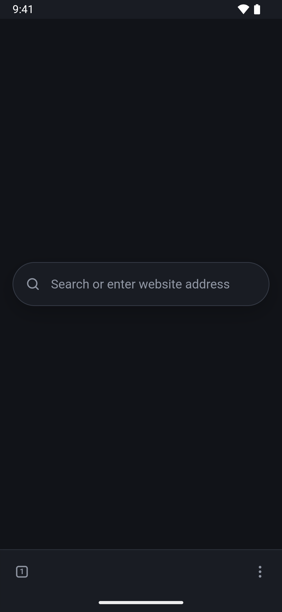

<p align="center">
  
</p>

<h1 align="center">Terra for Android</h1>

<p align="center">
  A clean, minimal web browser with vertical tabs, for your phone.
</p>

<p align="center">
  <a href="https://github.com/ttttima/Terra-mobile/releases"></a>
  
  <a href="LICENSE"></a>
</p>

<p align="center">
  
</p>

The phone version of [Terra](https://github.com/ttttima/Terra-Browser): the same
browser and the same design, laid out for a phone.

## Install

On your phone, open the [Releases](https://github.com/ttttima/Terra-mobile/releases)
page, download the newest `Terra-x.y.z.apk` and open it. Android asks once
whether your browser or file manager may install apps: allow it, then tap
**Install**. Terra needs Android 10 or newer.

## Update

Terra checks for a new version once a day and asks whether to install it.
You can also download the newest APK from
[Releases](https://github.com/ttttima/Terra-mobile/releases) and open it: it
installs over the old version and keeps your tabs, bookmarks and passwords.

## Features

- **Made for your thumb**: the toolbar sits at the bottom, with the tabs
  button, a quiet address bar that shows only the site name, and the menu
- **Vertical tabs** in a drawer from the left: swipe a tab sideways to close
  it, hold it to move it or open its menu
- **Swipe through tabs**: slide the address bar sideways to switch tabs;
  past the first one opens a new tab page
- **Fluid motion**: the drawer, menus and tabs follow your finger, keep its
  speed when you let go and can be caught mid-flight; pages slide between
  tabs
- **Clean new tab page**: just a search bar, nothing else
- **Picks up where you left off**: your tabs come back after a restart,
  with pinned tabs, muting and private tabs
- **Smart address bar**: suggestions from your history, bookmarks and open
  tabs as you type, and a lock that shows whether a site is secure
- **Bookmarks** sorted into folders you make
- **Passwords**: saved encrypted with your phone's keystore and filled in
  when you sign in; import them from a CSV
- **History and Downloads** pages: search, reopen and remove visits; open,
  retry and remove downloads
- **Everyday tools**: find on page, share,
  desktop site, and menus when you hold a link or picture
- **Ad and tracker blocking**, which you can turn off for a single site
- **Sites ask first** before using your camera, microphone or location
- **Color modes**: dark, light and OLED (pure black), with any accent
  color and a background tint
- **Liquid glass**: an optional frosted glass background with soft light
  in the colors of your accent or the open website
- **Force dark mode**: makes every website dark
- **Smooth dividers**: soft gradients between areas instead of hard lines
- **Protected video and music** (DRM) through Android's Widevine
- **Can be your default browser**: Settings → Navigation → Make default
- **Everything stays on your phone**: history, bookmarks, passwords and
  settings are never sent anywhere

What the desktop has and the phone doesn't: the "Behind the window" glass,
window animations, the compact sidebar, keyboard shortcuts and importing
from other browsers.

## Uninstall

Hold the Terra icon, choose **App info → Uninstall**. Your tabs, history,
bookmarks and passwords are removed with it.

## Build from source

You need [Node.js](https://nodejs.org) and
[Android Studio](https://developer.android.com/studio) (for its Java and the
Android SDK).

```bash
npm install
npm run apk          # build out/Terra-x.y.z.apk
npm run apk -- debug # a debug build (inspect pages from Chrome)
npm run dev          # the UI in a normal browser, without the native app
```

The first release build makes a signing key in `android/terra-release.jks`
with its passwords in `android/keystore.properties`. Neither is committed.
Keep both: updates install only over an app signed with the same key.

The UI shares code with the desktop app: `src/shared.ts`, `src/ui-*.ts`,
`src/suggest-local.ts` and `src/index.css` are the same files as in
[Terra](https://github.com/ttttima/Terra-Browser), so a change to them belongs in
both.

## License

[MIT](LICENSE)
